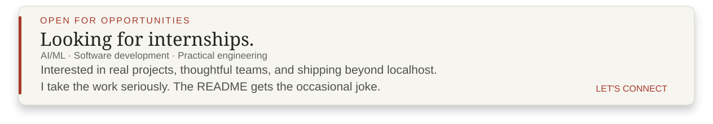
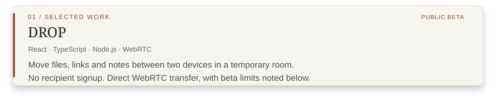
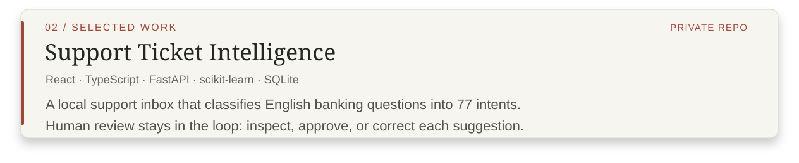
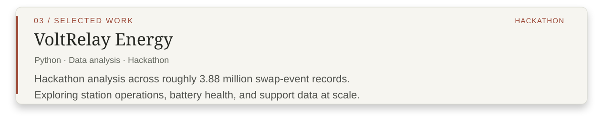

<!-- Decorative SVGs are inside <picture> so they display without linking to the raw SVG. All navigation is through explicit text links. -->

<picture></picture>

  <a href="https://www.linkedin.com/in/aluvala-pranav-teja">LinkedIn ↗</a>
  &nbsp; · &nbsp;
  <a href="mailto:pranavteja.aluvala@gmail.com">Email ↗</a>
  &nbsp; · &nbsp;
  <a href="https://leetcode.com/u/A-pranavTeja/">LeetCode ↗</a>

<picture></picture>

## A little about me.

I'm a **third-year CSE student at KITSW, Warangal**, exploring machine learning, data analysis, and software development. Random project ideas arrive at 2 AM. Remembering to commit them is a separate problem.

**Fifth semester** · **CGPA 8.82** · **Latest SGPA 9.65**

## Things I am familiar with.

<picture></picture>

## Selected projects.

<picture></picture>

Move a file, link, or note between two devices using a temporary room. No recipient signup, just pairing and a direct WebRTC connection when the network cooperates.

**Status:** Direct-only public beta. Some networks require a relay; real-device/cross-network certification, independent security review, and capacity testing remain pending. Avoid sensitive files during the beta.

[Repository ↗](https://github.com/Pranav-Teja-Aluvala/Drop) · [Try the public beta ↗](https://drop-devs-52b0.vercel.app) · [Security notes ↗](https://github.com/Pranav-Teja-Aluvala/Drop/blob/main/SECURITY.md)

<picture></picture>

A local support inbox that classifies banking questions into **77 intents** and lets a reviewer accept or correct its recommendations. The model suggests; the human decides.

**Recorded result:** 90.20% held-out test accuracy with TF-IDF and logistic regression on a processed BANKING77 split. Single-user local demo, not a production support desk.

*Private repository · Project summary only*

<picture></picture>

Explored station operations, battery health, and support data across approximately **3.88 million swap-event records**. The dataset had opinions about RAM.

[View project ↗](https://github.com/Pranav-Teja-Aluvala/gradient-data-analytics-hackathon-2026)

## Certificates & learning.

<picture></picture>

Turns out there's a whole Google Drive full of certificates. Listing everything here would turn this README into a terms-and-conditions document. **FR.**

So they got a dedicated page. By "I built it," I mean **my agent**. I provided the instructions and complained when something broke. Project management, apparently.

*Machine learning · Skill assessments · Hackathons · Simulations*

[View the certificate collection ↗](https://pranav-teja-aluvala.github.io/Pranav-Teja-Aluvala/certs.html)

## Human.exe | Still in beta.

| Patch | Status |
| :--- | :--- |
| `feat:` | 2 AM ideas keep becoming real projects. |
| `fix:` | Trying to remember Git commits before they become folklore. |
| `refactor:` | Learning to explain *why* the code works. |
| `background:` | Music. Almost always. |
| `main quest:` | Get an internship. |
| `side quest:` | Get a life. Pending. |

<picture></picture>

I'm looking for internships in **AI/ML, software development, and practical engineering**, where I can contribute to real projects, learn from a team, and ship useful work beyond localhost.

[✉ Email me ↗](mailto:pranavteja.aluvala@gmail.com?subject=Internship%20Opportunity) · [Connect on LinkedIn ↗](https://www.linkedin.com/in/aluvala-pranav-teja)
