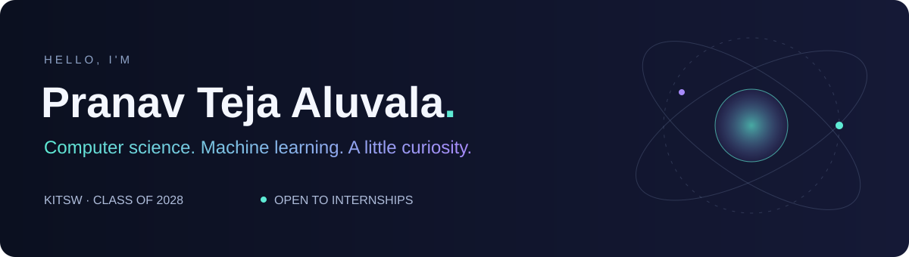
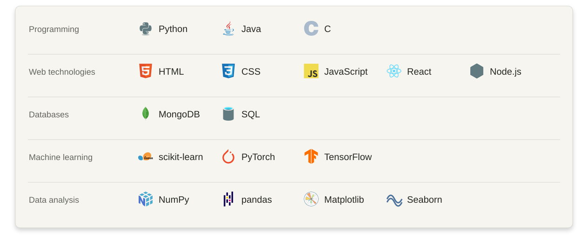
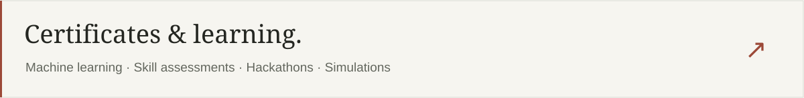

<picture>
  <source media="(prefers-reduced-motion: reduce)" srcset="assets/header-static.svg">
  
</picture>

  
  &nbsp;
  
  &nbsp;
  

I'm a **third-year CSE student at KITSW, Warangal**, exploring machine learning, data analysis, and software development. I like understanding how things work—and learning how to build them better.

🎓 **2024–2028** &nbsp; · &nbsp; 📚 **Fifth semester** &nbsp; · &nbsp; **CGPA 8.82** &nbsp; · &nbsp; **Latest SGPA 9.65**

Currently strengthening my ML fundamentals and looking for **internships and people to learn with**.

### Toolkit

Technologies I’m working with and continuing to learn.

<b>A little work behind the learning ↗</b>

**[VoltRelay Energy — Gradient Data Analytics Hackathon](https://github.com/Pranav-Teja-Aluvala/gradient-data-analytics-hackathon-2026)**

A Python notebook exploring station operations, battery health, and customer support data, with a processing workflow for approximately **3.88 million swap-event records**.

