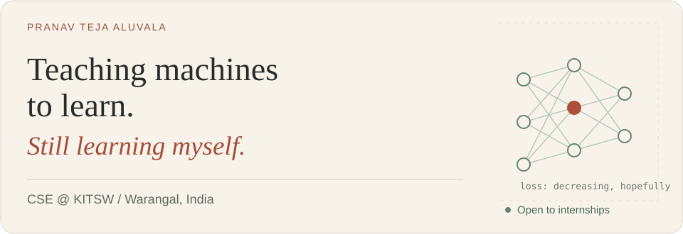
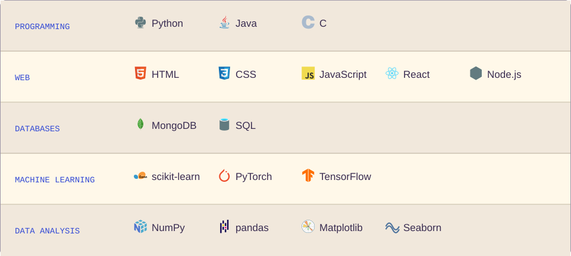
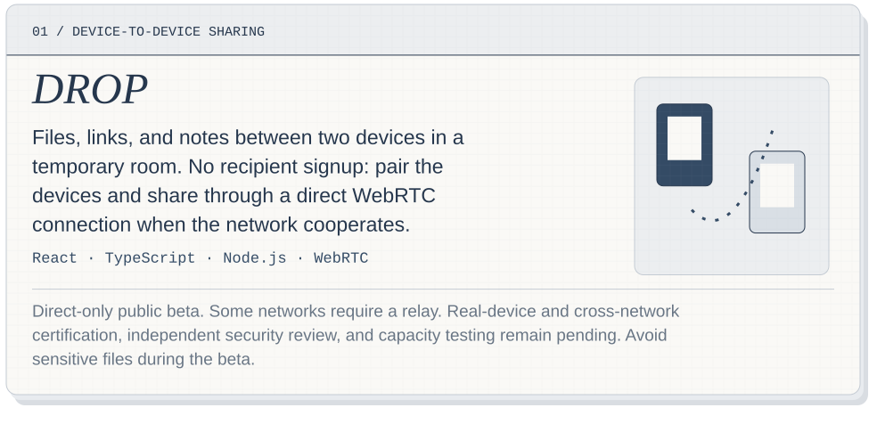
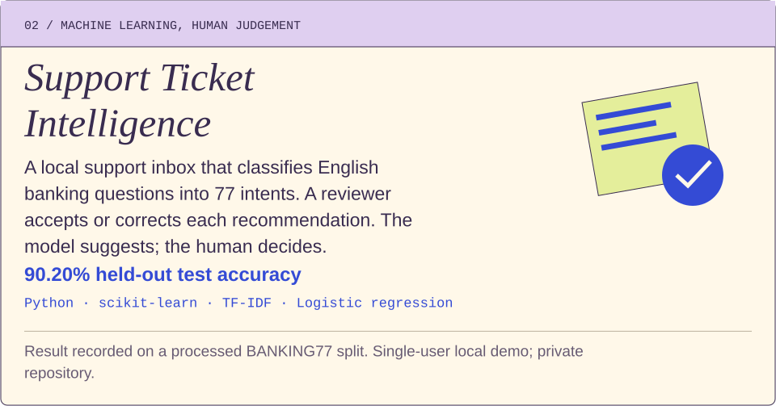
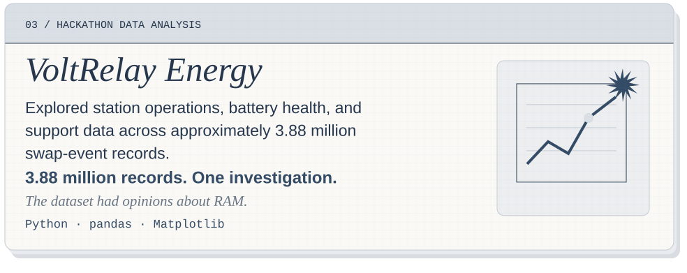

[LinkedIn](https://www.linkedin.com/in/aluvala-pranav-teja) · [Email](mailto:pranavteja.aluvala@gmail.com) · [LeetCode](https://leetcode.com/u/A-pranavTeja/) · [Certificates](https://pranav-teja-aluvala.github.io/Pranav-Teja-Aluvala/certs.html)

## A little about me

I'm a third-year CSE student who likes turning ideas into working projects, especially where data and software meet. The ideas usually arrive at 2 AM; remembering to commit them is an ongoing side quest.

**Fifth semester** · **CGPA 8.82** · **Latest SGPA 9.65**

## My toolkit

## Selected projects

**Device-to-device sharing** · `React` · `TypeScript` · `Node.js` · `WebRTC`

Move a file, link, or note between two devices in a temporary room. No recipient signup; pair the devices and share through a direct WebRTC connection when the network cooperates.

[Repository](https://github.com/Pranav-Teja-Aluvala/Drop) · [Try the public beta](https://drop-devs-52b0.vercel.app) · [Security notes](https://github.com/Pranav-Teja-Aluvala/Drop/blob/main/SECURITY.md)

Beta status & limitations

Direct-only public beta. Some networks require a relay. Real-device and cross-network certification, independent security review, and capacity testing remain pending. Avoid sensitive files during the beta.

**Human-reviewed text classification** · `Python` · `scikit-learn`

A local support inbox that classifies English banking questions into **77 intents** and lets a reviewer accept or correct its recommendations. The model suggests; the human decides.

- **Result:** 90.20% held-out test accuracy with TF-IDF and logistic regression on a processed BANKING77 split.
- **Scope:** Single-user local demo; private repository.

**Hackathon data analysis** · `Python` · `pandas` · `Matplotlib`

Explored station operations, battery health, and support data across approximately **3.88 million swap-event records**. The dataset had opinions about RAM.

[Explore the project](https://github.com/Pranav-Teja-Aluvala/gradient-data-analytics-hackathon-2026)

## Learning & certificates

Machine learning, skill assessments, hackathons, and simulations. The full collection lives on its own page to keep this one readable.

[Browse my certificates →](https://pranav-teja-aluvala.github.io/Pranav-Teja-Aluvala/certs.html)

## Human.exe · Still in beta

`listening to music`　`debugging at 2 AM`　`git commit… eventually`

- **Background process:** Music. Almost always.
- **Current refactor:** Learning to explain why the code works.
- **Main quest:** Get an internship.
- **Side quest:** Get a life. Pending.

I built the certificate page with help from my agent. I provided the instructions and complained when something broke. Project management, apparently.

Have something interesting to build? [Email me](mailto:pranavteja.aluvala@gmail.com?subject=Internship%20Opportunity) or [connect on LinkedIn](https://www.linkedin.com/in/aluvala-pranav-teja).
