<picture>
  <source media="(max-width: 600px)" srcset="assets/header-mobile.svg">
  
</picture>

 

<a href="https://www.linkedin.com/in/aluvala-pranav-teja"></a>
<a href="mailto:pranavteja.aluvala@gmail.com"></a>
<a href="https://leetcode.com/u/A-pranavTeja/"></a>
<a href="https://pranav-teja-aluvala.github.io/Pranav-Teja-Aluvala/certs.html">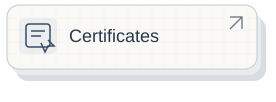</a>

<picture>
  <source media="(max-width: 600px)" srcset="assets/about-mobile.svg">
  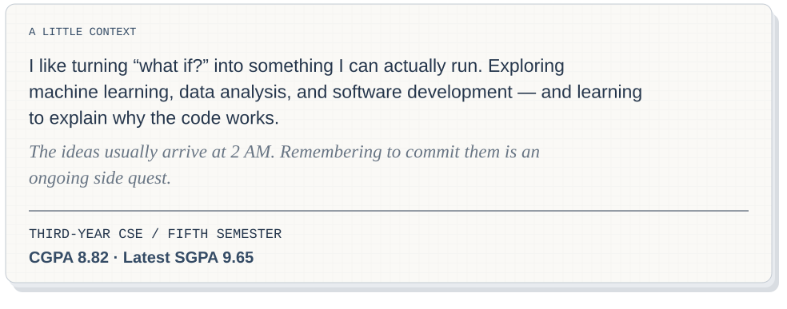
</picture>

 

<picture>
  <source media="(max-width: 600px)" srcset="assets/section-tools-mobile.svg">
  
</picture>

 

<picture>
  <source media="(max-width: 600px)" srcset="assets/toolkit-mobile.svg">
  
</picture>

 

<picture>
  <source media="(max-width: 600px)" srcset="assets/section-projects-mobile.svg">
  
</picture>

 

<picture>
  <source media="(max-width: 600px)" srcset="assets/project-drop-mobile.svg">
  
</picture>

 

<a href="https://github.com/Pranav-Teja-Aluvala/Drop"></a> <a href="https://drop-devs-52b0.vercel.app"></a> <a href="https://github.com/Pranav-Teja-Aluvala/Drop/blob/main/SECURITY.md">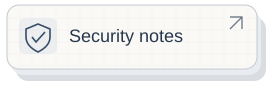</a>

 

<picture>
  <source media="(max-width: 600px)" srcset="assets/project-tickets-mobile.svg">
  
</picture>

 

<picture>
  <source media="(max-width: 600px)" srcset="assets/project-voltrelay-mobile.svg">
  
</picture>

 

<a href="https://github.com/Pranav-Teja-Aluvala/gradient-data-analytics-hackathon-2026">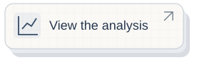</a>

 

<picture>
  <source media="(max-width: 600px)" srcset="assets/section-more-mobile.svg">
  
</picture>

 

<picture>
  <source media="(max-width: 600px)" srcset="assets/certificates-mobile.svg">
  
</picture>

 

<a href="https://pranav-teja-aluvala.github.io/Pranav-Teja-Aluvala/certs.html"></a>

 

<picture>
  <source media="(max-width: 600px)" srcset="assets/human-mobile.svg">
  
</picture>

 

<picture>
  <source media="(max-width: 600px)" srcset="assets/internship-card-mobile.svg">
  
</picture>

 

<a href="mailto:pranavteja.aluvala@gmail.com?subject=Internship%20Opportunity"></a>

