# Certificates

[Open the interactive gallery ↗](https://pranav-teja-aluvala.github.io/Pranav-Teja-Aluvala/certs.html) · [Back to profile](README.md)

## AI & ML

<table>
<tr>
<td width="50%" align="center" valign="top"><a href="assets/certificates/machine-learning-specialization.jpg">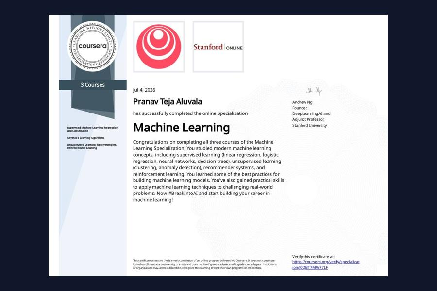</a> <b>Machine Learning Specialization</b> DeepLearning.AI &amp; Stanford Online · Coursera · Jul 2026</td>
<td width="50%" align="center" valign="top"><a href="assets/certificates/agentic-ai-certified-foundations-associate.jpg">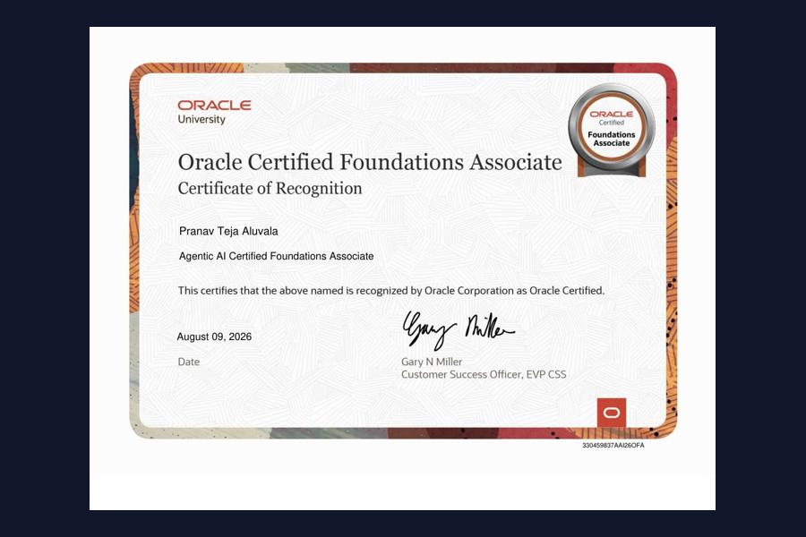</a> <b>Agentic AI Certified Foundations Associate</b> Oracle · Aug 2026</td>
</tr>
<tr>
<td width="50%" align="center" valign="top"><a href="assets/certificates/career-essentials-in-generative-ai.jpg">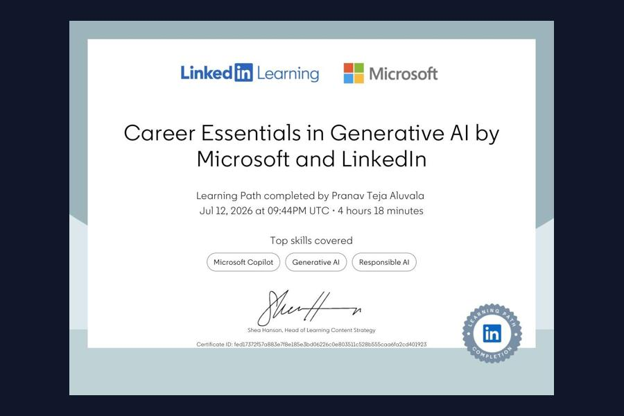</a> <b>Career Essentials in Generative AI</b> Microsoft &amp; LinkedIn · Jul 2026</td>
<td width="50%" align="center" valign="top"> <b>Advanced Learning Algorithms</b> DeepLearning.AI &amp; Stanford Online · Coursera · Jul 2026</td>
</tr>
<tr>
<td width="50%" align="center" valign="top"><a href="assets/certificates/unsupervised-learning-recommenders-reinforcement-learning.jpg">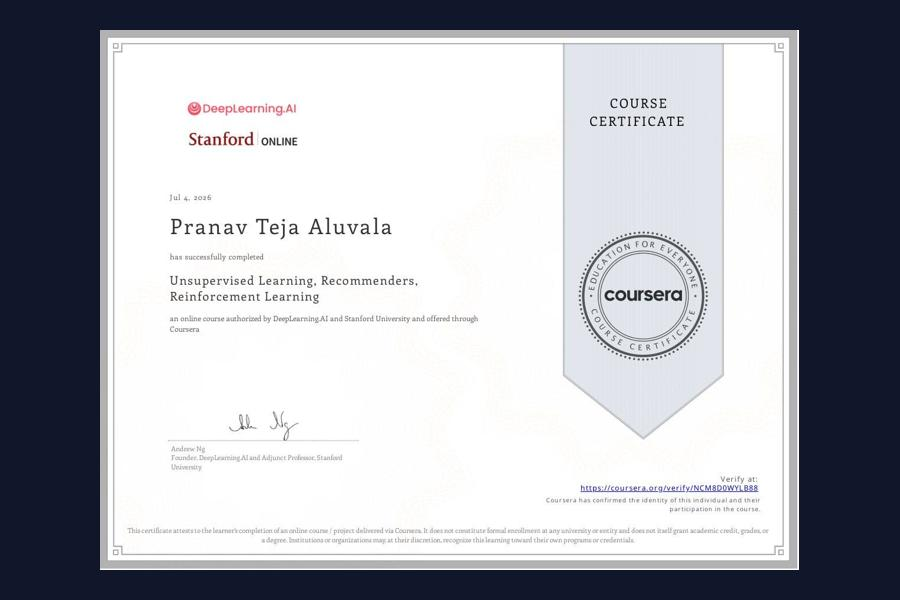</a> <b>Unsupervised Learning, Recommenders, Reinforcement Learning</b> DeepLearning.AI &amp; Stanford Online · Coursera · Jul 2026</td>
<td width="50%" align="center" valign="top"><a href="assets/certificates/introduction-to-machine-learning-art-of-the-possible.jpg">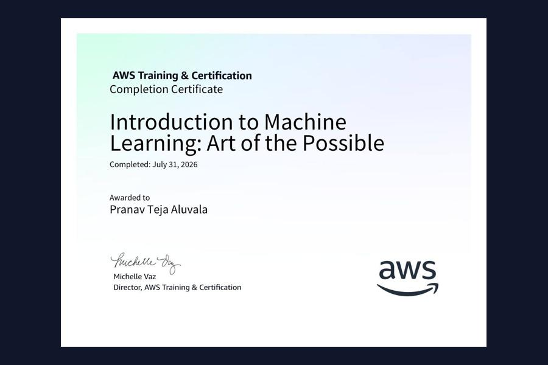</a> <b>Introduction to Machine Learning: Art of the Possible</b> AWS Training &amp; Certification · Jul 2026</td>
</tr>
<tr>
<td width="50%" align="center" valign="top"><a href="assets/certificates/ai-data-engineering-analyst.jpg">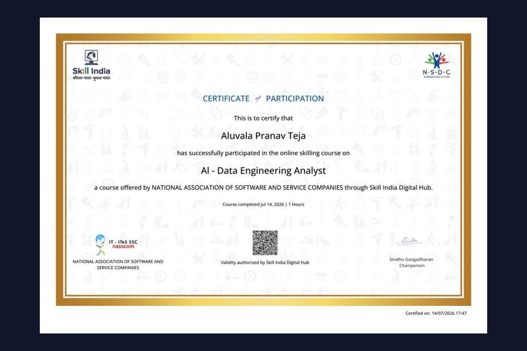</a> <b>AI – Data Engineering Analyst</b> NASSCOM · Skill India Digital Hub · Jul 2026</td>
<td width="50%" align="center" valign="top"><a href="assets/certificates/ethics-in-the-age-of-generative-ai.jpg">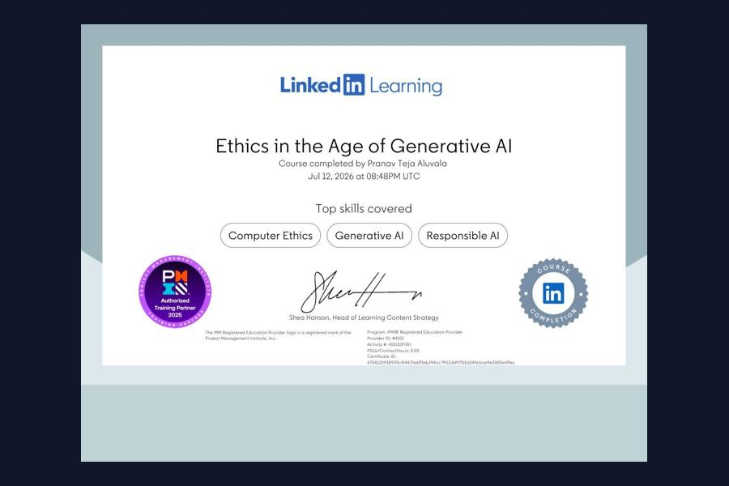</a> <b>Ethics in the Age of Generative AI</b> LinkedIn Learning · Jul 2026</td>
</tr>
<tr>
<td width="50%" align="center" valign="top"><a href="assets/certificates/everyday-ai-concepts.jpg">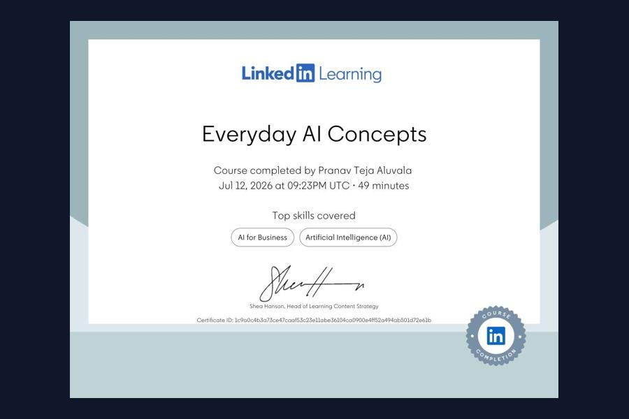</a> <b>Everyday AI Concepts</b> LinkedIn Learning · Jul 2026</td>
<td width="50%" align="center" valign="top"><a href="assets/certificates/what-is-generative-ai.jpg">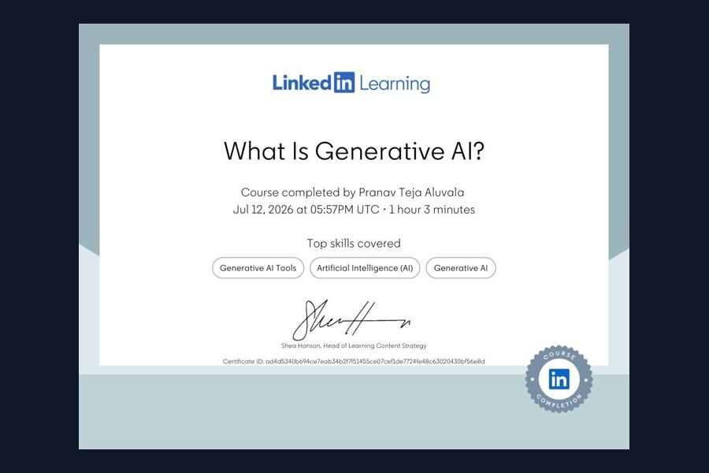</a> <b>What Is Generative AI?</b> LinkedIn Learning · Jul 2026</td>
</tr>
<tr>
<td width="50%" align="center" valign="top"><a href="assets/certificates/your-top-ai-questions-answered-ai-literacy-for-everyone.jpg">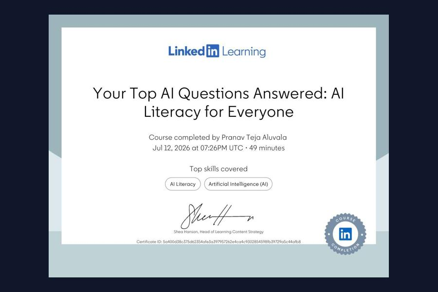</a> <b>Your Top AI Questions Answered: AI Literacy for Everyone</b> LinkedIn Learning · Jul 2026</td>
<td width="50%"></td>
</tr>
</table>

## Programming

<table>
<tr>
<td width="50%" align="center" valign="top"><a href="assets/certificates/python-basic.jpg">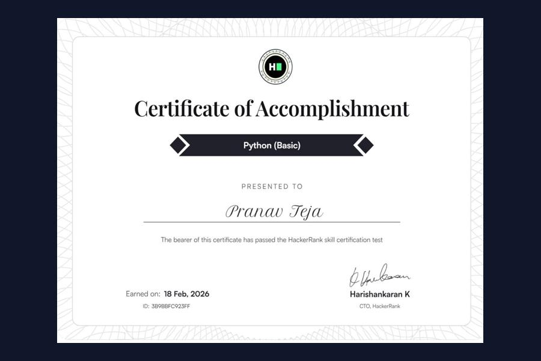</a> <b>Python (Basic)</b> HackerRank · Feb 2026</td>
<td width="50%" align="center" valign="top"><a href="assets/certificates/java-basic.jpg">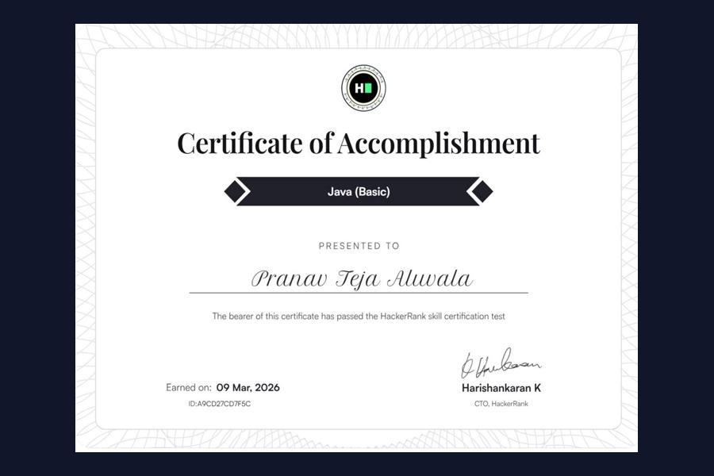</a> <b>Java (Basic)</b> HackerRank · Mar 2026</td>
</tr>
<tr>
<td width="50%" align="center" valign="top"><a href="assets/certificates/sql-basic.jpg">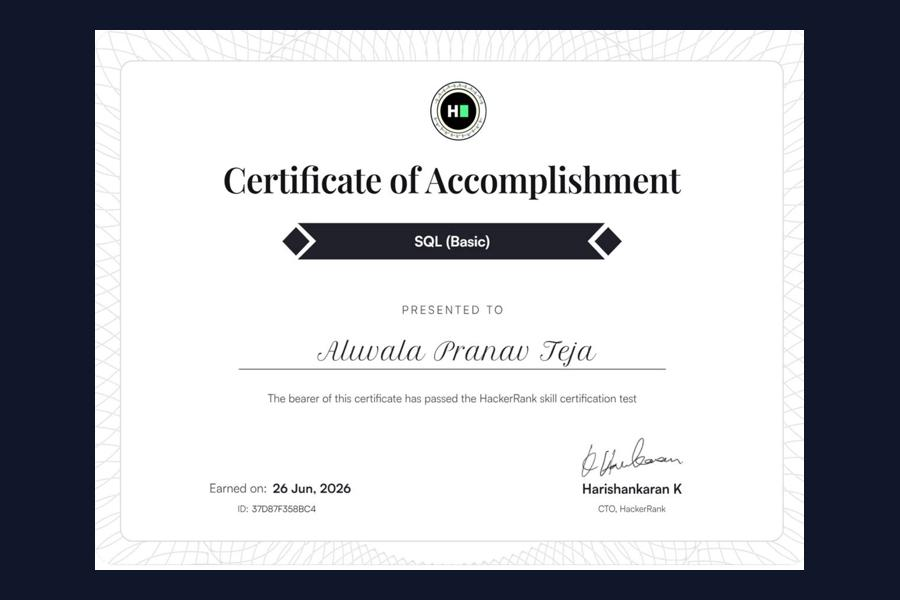</a> <b>SQL (Basic)</b> HackerRank · Jun 2026</td>
<td width="50%" align="center" valign="top"> <b>CSS (Basic)</b> HackerRank · Jun 2026</td>
</tr>
</table>

## Simulations

<table>
<tr>
<td width="50%" align="center" valign="top"><a href="assets/certificates/genai-powered-data-analytics.jpg">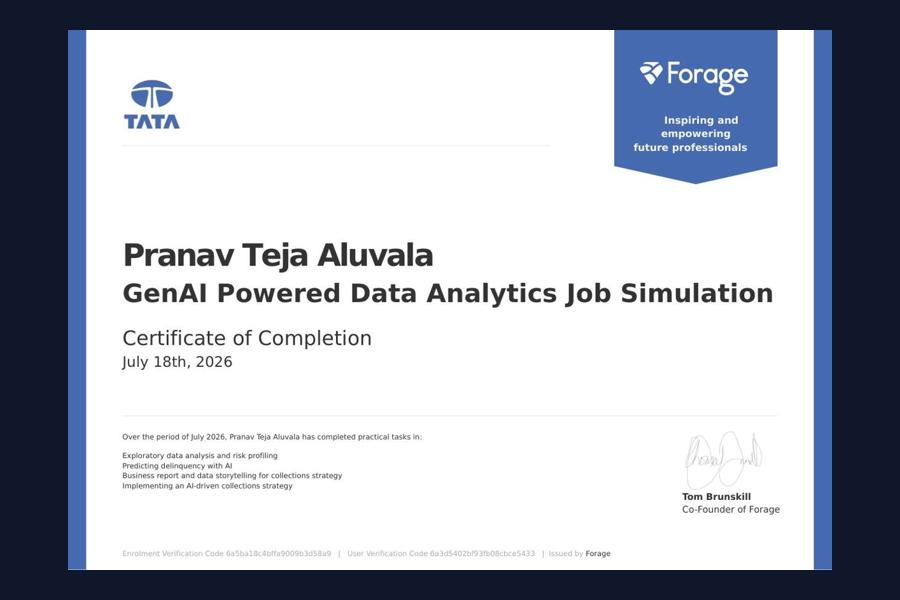</a> <b>GenAI Powered Data Analytics</b> Tata · Forage · Jul 2026</td>
<td width="50%" align="center" valign="top"><a href="assets/certificates/data-analytics.jpg">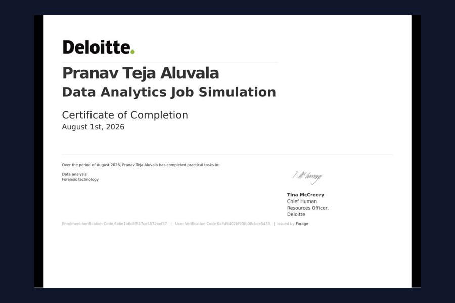</a> <b>Data Analytics</b> Deloitte Australia · Forage · Aug 2026</td>
</tr>
<tr>
<td width="50%" align="center" valign="top"><a href="assets/certificates/genai.jpg">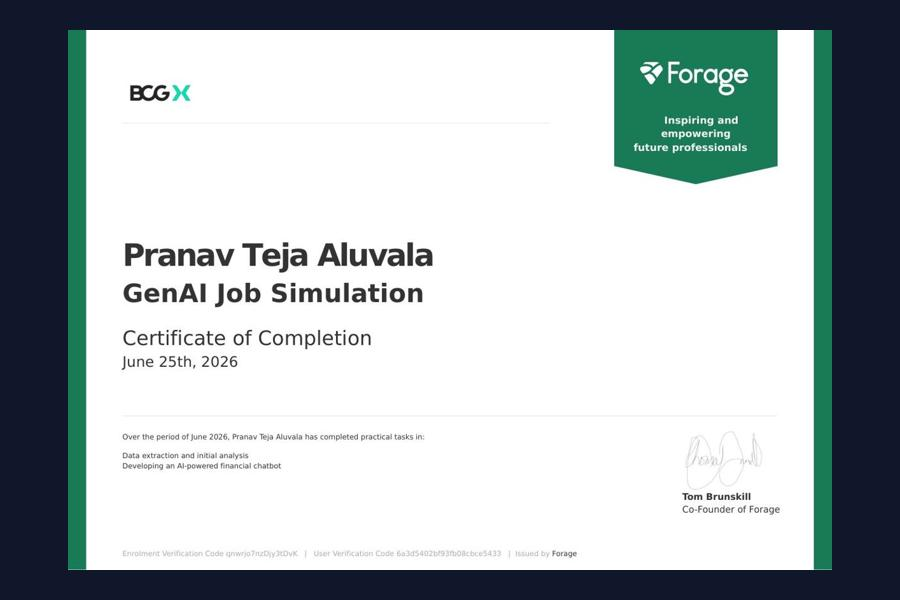</a> <b>GenAI</b> BCG X · Forage · Jun 2026</td>
<td width="50%" align="center" valign="top"><a href="assets/certificates/partnering-with-ai-in-the-workplace.jpg">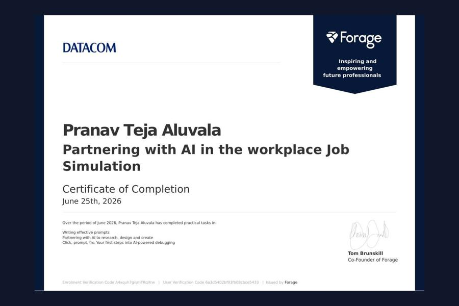</a> <b>Partnering with AI in the Workplace</b> Datacom · Forage · Jun 2026</td>
</tr>
<tr>
<td width="50%" align="center" valign="top"><a href="assets/certificates/cybersecurity.jpg">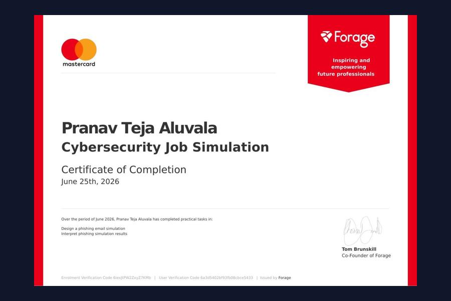</a> <b>Cybersecurity</b> Mastercard · Forage · Jun 2026</td>
<td width="50%"></td>
</tr>
</table>

## Programs

<table>
<tr>
<td width="50%" align="center" valign="top"><a href="assets/certificates/virtual-data-science-with-python-apprentice-intern.jpg">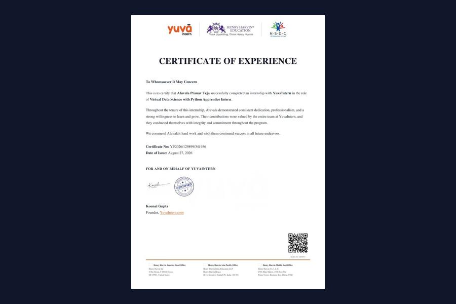</a> <b>Virtual Data Science with Python Apprentice Intern</b> YuvaIntern · Aug 2026</td>
<td width="50%"></td>
</tr>
</table>

## Participation

<table>
<tr>
<td width="50%" align="center" valign="top"><a href="assets/certificates/data-analytics-hackathon.jpg">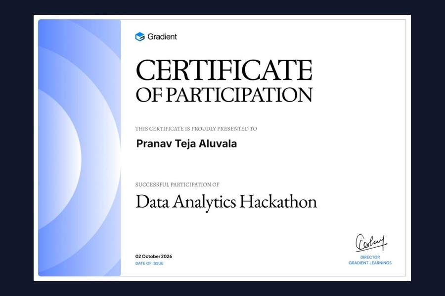</a> <b>Data Analytics Hackathon</b> Gradient Learnings · Oct 2026</td>
<td width="50%" align="center" valign="top"><a href="assets/certificates/adobe-university-hackathon.jpg">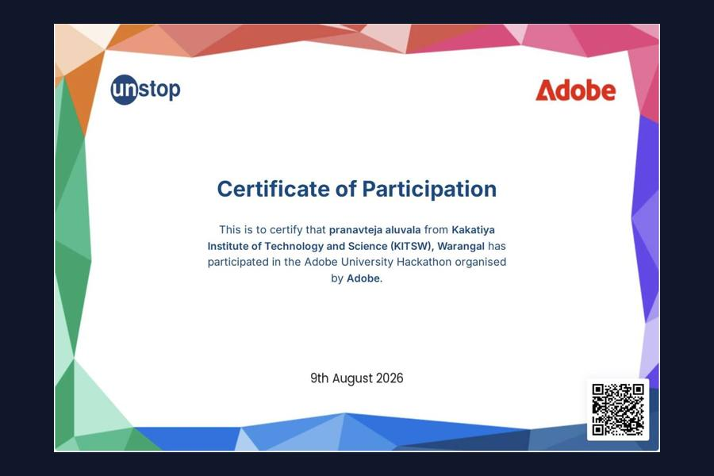</a> <b>Adobe University Hackathon</b> Adobe · Unstop · 2026</td>
</tr>
<tr>
<td width="50%" align="center" valign="top"><a href="assets/certificates/geeks2code-hackathon.jpg">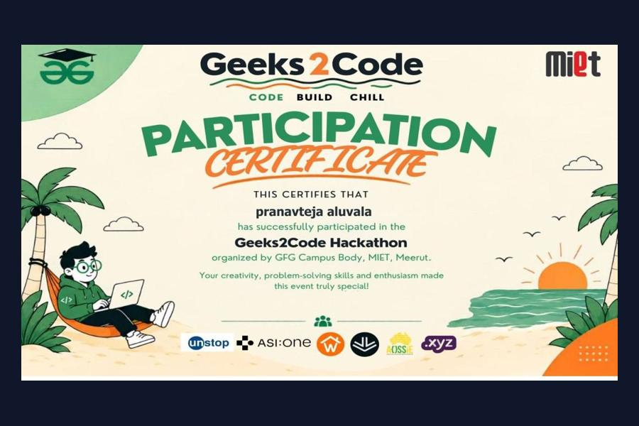</a> <b>Geeks2Code Hackathon</b> GFG Campus Body · MIET, Meerut · Date not listed</td>
<td width="50%"></td>
</tr>
</table>

